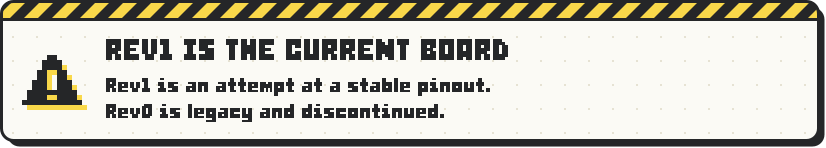
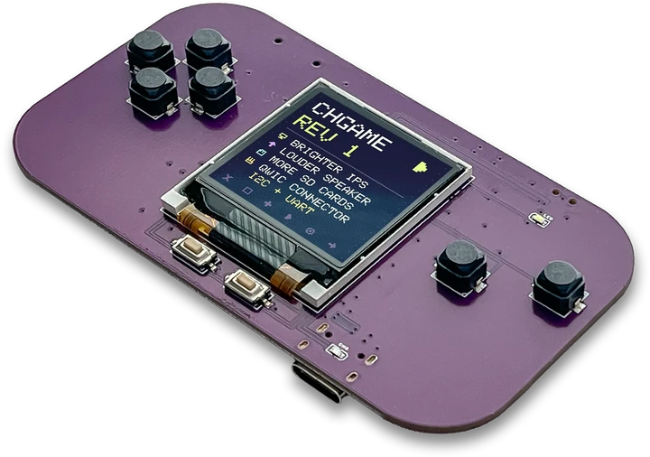
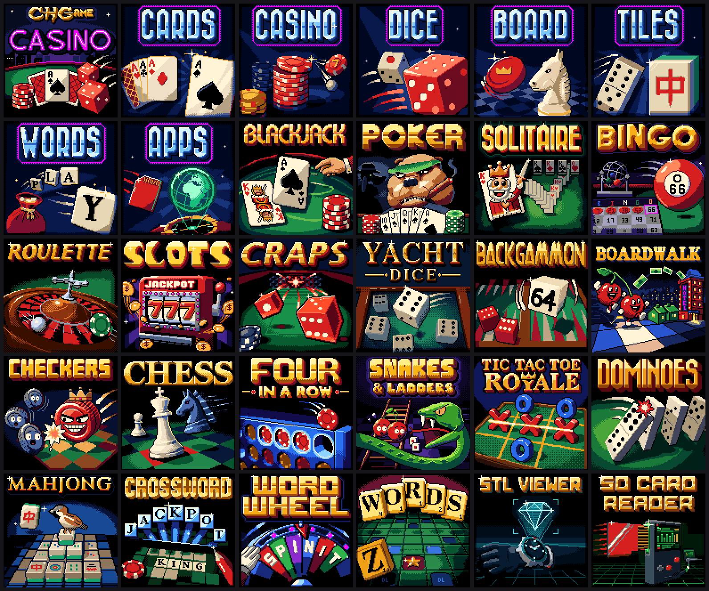

<a id="readme-top"></a>

<div align="center">

<a href="https://chgame.website"></a>

<p>
<a href="https://chgame.website"></a>&nbsp;
<a href="#-get-started"></a>&nbsp;
<a href="https://bateske.github.io/CHGame/"></a>&nbsp;
<a href="https://www.arduboy.com/shop/p/chgame"></a>&nbsp;
<a href="https://community.arduboy.com/c/color/56"></a>
</p>

[](https://github.com/bateske/CHGame/releases/latest)
[](#-get-started)
[](docs/platform.md)
[](https://bateske.github.io/CHGame/)

<br>



<br>

</div>

**CHGame** is a small, open, low-cost handheld that you program in Arduino:
a 48 MHz RISC-V chip, a 128x128 colour screen, eight buttons, a speaker, a
microSD slot and a battery on one bare board. Plug in USB-C and press
Upload: no programmer, no driver, no buttons to hold. This repository is
everything that runs on it: the Arduino board package, the game menu built
into the bootloader, the libraries games are written with, twenty casino
games, and the PC tools (simulator, uploader, card builder).

<p align="center">
<a href="#-what-it-is">What it is</a> ·
<a href="#-what-changed-in-rev1">What changed in Rev1</a> ·
<a href="#-get-started">Get started</a> ·
<a href="#-the-games">The games</a> ·
<a href="#-the-game-menu">The game menu</a> ·
<a href="#-for-developers">For developers</a> ·
<a href="#-documentation">Documentation</a> ·
<a href="#-licences">Licences</a> ·
<a href="#-credits">Credits</a>
</p>

## 🎮 What it is



| Board | CHGame Rev1 (Rev 1 and Rev 1.5 boards) |
|---|---|
| **Chip** | 32-bit RISC-V at 48 MHz (WCH CH32X035) |
| **Memory** | 62 KB flash, 20 KB RAM, a microSD slot |
| **Screen** | 128x128 colour LCD, 16 colours of 4,096 |
| **Buttons** | eight: the D-pad, A, B, START, SELECT |
| **Sound** | a magnetic buzzer, and a status LED |
| **Power** | USB-C and a LiPo battery |

It works like an Arduboy. Install one board package, write a sketch with
one include (`CHGame.h`) and upload it over USB. Switch it on and the
**game menu** in the bootloader lists the games on the SD card: pick one
and play, with no PC.

<br clear="right">

### The built-in games

[Twenty casino games and three apps](#-the-games), packed for the game
menu with every release:

<!-- downloads:start (tools/release/downloads.py writes this line) -->
**0.4.0**: [`CHGame-Casino-0.4.0.chgame`](https://github.com/bateske/CHGame/releases/download/v0.4.0/CHGame-Casino-0.4.0.chgame) · [`CHGame-sdcard-0.4.0-rev1.zip`](https://github.com/bateske/CHGame/releases/download/v0.4.0/CHGame-sdcard-0.4.0-rev1.zip)
<!-- downloads:end -->

Unzip the `.zip` onto a FAT32 microSD card and switch on. The `.chgame` is
the same collection in one file ([the format](spec/chgame.md)):
`chgame cart deploy <file> --card E:\` writes a card from it.

### Why one repository

Everything that runs on CHGame lives here and ships together, the way the
Arduboy does it but in one place: **one board package** install gives you
the core, the RISC-V toolchain, a driverless uploader, the bootloaders, the
libraries and twenty finished games to learn from; **one include**,
`CHGame.h`, gives a sketch buttons, frame pacing, graphics, sound, saving
and a debug protocol with no pin set-up; and because the core, libraries,
bootloader, examples and PC tools are built and tested together, **one
release** delivers a fix in any layer to everyone. The repositories the
pieces grew up in are frozen; [the roadmap](docs/roadmap.md) says what's
next.

<p align="right"><a href="#readme-top">back to top ↑</a></p>

## 🔧 What changed in Rev1

> [!IMPORTANT]
> **Rev1 is an attempt at a stable pinout.** The system specification is
> still subject to change. Rev 1.5 boards use the same pins and builds.

Same chip, memory map, screen and buttons as Rev0, on new pins. The pins
moved to make room for what the board can grow into:

- **The D-pad sits on four ADC-capable pins** (A8, A9, A10, A13), leaving
  room for analog controls later, and avoiding the ADC channels some chip
  lots lack.
- **PC14 and PC15 are free for USB-C's CC lines**, which Rev 1.5 uses for
  USB-PD; on Rev 1 they are test pads.
- **PA0 senses USB power** (and switches host power on Rev 1.5).
- **The backlight and LED share TIM1** (PB9, PB10), so both can dim with
  PWM, and **the buzzer has TIM2 to itself** (PA1), so a tone never
  changes them.
- **The SD card's chip select also gates its data line** (PB3), so a
  deselected card ignores the screen's traffic on the shared SPI bus.
- **I2C and the UART get their own connectors** (CN2, CN3) for
  accessories.

Games must be recompiled for each target; the source doesn't change. A `.chgame`
cart can carry a binary for each hardware revision
([the cart format](spec/chgame.md#binaries-and-devices)).

<details>
<summary><b>The pinout</b>: every pin, Rev1 and Rev0</summary>

| Function | Name in a sketch | Rev1 | Rev0 (legacy) |
|---|---|---|---|
| D-pad UP | `PIN_BTN_UP` | PB0 | PB4 |
| D-pad DOWN | `PIN_BTN_DOWN` | PB1 (bonded to PB5) | PC14 |
| D-pad LEFT | `PIN_BTN_LEFT` | PC3 | PB3 |
| D-pad RIGHT | `PIN_BTN_RIGHT` | PC0 | PC15 |
| A | `PIN_BTN_A` | PB11 | PB1 |
| B | `PIN_BTN_B` | PB6 | PB6 |
| SELECT | `PIN_BTN_SELECT` | PB7 | PB7 |
| START | `PIN_BTN_START` | PB8 | PB8 |
| LCD chip select | `PIN_LCD_CS` | PA4 | PA4 |
| LCD data/command | `PIN_LCD_DC` | PB4 | PB0 |
| LCD reset | `PIN_LCD_RST` | PB12 | PB12 |
| LCD backlight | `PIN_LCD_BL` | PB9, active high | always on |
| SD card chip select | `PIN_SD_CS` | PB3 (also gates the card's DI) | PB11 |
| SPI1 SCK | `PIN_SPI_SCK` | PA5 | PA5 |
| SPI1 MISO | `PIN_SPI_MISO` | PA6 | PA6 |
| SPI1 MOSI | `PIN_SPI_MOSI` | PA7 | PA7 |
| Speaker | `PIN_BUZZER` | PA1, magnetic buzzer (TIM2 CH2) | PB10, piezo (TIM1 CH2) |
| Status LED | `PIN_LED`, `LED_BUILTIN` | PB10 | PB9 |
| USB power sense | `PIN_VBUS_SENSE` | PA0, analog input | – |
| Test pad TP14 | `PIN_TP14` | PC14 | – |
| Test pad TP15 | `PIN_TP15` | PC15 | – |
| `Serial1` TX | `PIN_SERIAL_TX` | PA2, connector CN3 | PA2, header H1 |
| `Serial1` RX | `PIN_SERIAL_RX` | PA3, connector CN3 | PA3, header H1 |
| `Wire` SDA | `PIN_WIRE_SDA` | PC18, connector CN2 | PC18 |
| `Wire` SCL | `PIN_WIRE_SCL` | PC19, connector CN2 | PC19 |
| USB D- | | PC16 | PC16 |
| USB D+ | | PC17 | PC17 |

Buttons read LOW when pressed (internal pull-ups). Full detail:
[hardware-pinmap.md](platform/board/docs/hardware-pinmap.md).

</details>

<p align="right"><a href="#readme-top">back to top ↑</a></p>

## 🚀 Get started

### 1. Install the board package

In the Arduino IDE 2.x, add this URL under *File > Preferences >
Additional boards manager URLs*, then install **CHGame** from the Boards
Manager:

```
https://github.com/bateske/CHGame/releases/latest/download/package_chgame_index.json
```

<details>
<summary>The same with <code>arduino-cli</code></summary>

```bash
arduino-cli config add board_manager.additional_urls https://github.com/bateske/CHGame/releases/latest/download/package_chgame_index.json
arduino-cli core update-index
arduino-cli core install CHGame:ch32v
```

</details>

That is everything: the toolchain, the uploader, the bootloaders, the
libraries and the games under *File > Examples*.

### 2. Pick the board

*Tools > Board > CHGame Boards > CHGame Rev1*. Rev 1.5 boards use it too.

### 3. Upload

Open *File > Examples > CHGame > Hello*, plug the board in and press
**Upload**. It resets itself, flashes in about half a second and starts.
For the games (*File > Examples > CHGame > Games*), set *Tools > USB* to
**Upload only**.

### 4. Write your own

Start from `Hello`, the smallest complete sketch, then:

- [Getting started](docs/getting-started.md): the guide, with the Arduboy2
  calls mapped to CHGame's.
- [API reference](https://bateske.github.io/CHGame/): every call in the
  libraries.
- [The CHGame library](platform/board/arduino/CHGame/libraries/CHGame/README.md):
  how a game is put together.

### Programming the bootloader

The game menu lives in the bootloader. *Tools > Bootloader*: **SD Text
Menu** or **SD Graphic Menu**; *Tools > Programmer*: **CHGame USB**; then
*Tools > Burn Bootloader*. It goes over USB, with no driver and no buttons.
A board that won't respond: [recovery](platform/board/docs/recovery.md).

<p align="right"><a href="#readme-top">back to top ↑</a></p>

## 🎰 The games

Twenty casino and table games with one look: green felt, gold lettering,
casino chips and a dealer. They are the platform's examples and its test
load (most are within 1 KB of filling the flash), and they all fit on one
SD card behind the game menu. Each one, and each app, has box art for the
visual menu, painted in the manner of early-1990s game boxes:



**On the SD card:** a release's card ([the built-in games](#the-built-in-games))
holds one board's games; the menu greys out games built for another board.
Hold **START** for 3 s in any game to go back to the menu
([the SD game menu](docs/sd-menu.md)).

Each game is a sketch in
`platform/board/arduino/CHGame/libraries/CHGame/examples/Games/<Name>/`
with its own README (rules, controls, design) and NOTES.md (status,
decisions, open items). The image column is the Rev1 release build's size with
the 0.4.0 package, against the **50,944 B** the bootloader
leaves for a sketch; up to 50,432 B a game keeps both of its save pages.

<details>
<summary><b>All twenty games</b>: what each one is, and its size</summary>

| Game | What it is | Image |
|---|---|---|
| [CHBackgammon](platform/board/arduino/CHGame/libraries/CHGame/examples/Games/CHBackgammon) | Backgammon on felt with chip checkers, a trained CPU, optional match play and doubling cube | 49,536 B |
| [CHBingo](platform/board/arduino/CHGame/libraries/CHGame/examples/Games/CHBingo) | 75-ball bingo: up to nine cards against a hall of rivals, power-ups and a jackpot | 40,768 B |
| [CHBlackjack](platform/board/arduino/CHGame/libraries/CHGame/examples/Games/CHBlackjack) | Press Play On Tape's Arduboy Blackjack rebuilt in colour: the series' first table | 46,128 B |
| [CHBoardwalk](platform/board/arduino/CHGame/libraries/CHGame/examples/Games/CHBoardwalk) | BOARDWALK, a property-trading board game on an isometric board, with tap auctions | 49,816 B |
| [CHCheckers](platform/board/arduino/CHGame/libraries/CHGame/examples/Games/CHCheckers) | Checkers on CHChess's isometric board, with its own engine and chip pieces | 41,888 B |
| [CHChess](platform/board/arduino/CHGame/libraries/CHGame/examples/Games/CHChess) | Isometric chess with a pointing glove, whip-zoom camera and a CPU of three strengths | 48,440 B |
| [CHCraps](platform/board/arduino/CHGame/libraries/CHGame/examples/Games/CHCraps) | Casino craps with 3D dice and Blackjack's dealer as the stickman | 50,276 B |
| [CHCrossword](platform/board/arduino/CHGame/libraries/CHGame/examples/Games/CHCrossword) | 13x13 crosswords, built in and as packs on the SD card | 50,024 B |
| [CHDominoes](platform/board/arduino/CHGame/libraries/CHGame/examples/Games/CHDominoes) | Dominoes (ALL FIVES and DRAW) with bevelled tiles and a close-up camera | 43,432 B |
| [CHFour](platform/board/arduino/CHGame/libraries/CHGame/examples/Games/CHFour) | FOUR IN A ROW, against the dealer as a friendly coach | 36,664 B |
| [CHMahjong](platform/board/arduino/CHGame/libraries/CHGame/examples/Games/CHMahjong) | Mahjong solitaire with the 144 traditional tiles and a close-up view | 48,764 B |
| [CHPoker](platform/board/arduino/CHGame/libraries/CHGame/examples/Games/CHPoker) | Poker against three CPU players: Hold'em, Five Card Draw, Omaha and Seven Card Stud | 48,988 B |
| [CHRoulette](platform/board/arduino/CHGame/libraries/CHGame/examples/Games/CHRoulette) | Roulette with a physically simulated ball and the dealer as croupier | 49,992 B |
| [CHSlots](platform/board/arduino/CHGame/libraries/CHGame/examples/Games/CHSlots) | Three slot machines on one purse: LUCKY 7, SWEET and DRAGON FORTUNE | 48,248 B |
| [CHSnakes](platform/board/arduino/CHGame/libraries/CHGame/examples/Games/CHSnakes) | SNAKES & LADDERS with procedural snakes, CLASSIC and ARCADE rules | 37,252 B |
| [CHSolitaire](platform/board/arduino/CHGame/libraries/CHGame/examples/Games/CHSolitaire) | Klondike, after the Windows original | 31,380 B |
| [CHTicTacToe](platform/board/arduino/CHGame/libraries/CHGame/examples/Games/CHTicTacToe) | TIC TAC TOE: ROYALE, sixteen tables on 3x3 and 5x5 boards, for money | 50,116 B |
| [CHWords](platform/board/arduino/CHGame/libraries/CHGame/examples/Games/CHWords) | A crossword tile game (Scrabble rules) with a flash dictionary and a full one on SD | 50,024 B |
| [CHWordWheel](platform/board/arduino/CHGame/libraries/CHGame/examples/Games/CHWordWheel) | WORD WHEEL, a word-puzzle game show: spin, call letters, solve | 50,112 B |
| [CHYacht](platform/board/arduino/CHGame/libraries/CHGame/examples/Games/CHYacht) | YACHT DICE (five dice, thirteen boxes) with Craps's 3D dice | 44,592 B |

</details>

The three apps sit beside them in `examples/Apps/`: **CHStlView** (a 3D
model viewer that streams STL files off the card), **CHSDtoUSB** (the board
as a USB card reader) and **CHSDtoSerial** (the card over serial, for the
website's tools). [docs/status.md](docs/status.md) lists what each game has
been verified on (the simulator or the device), its open items and the
known issues.

<p align="right"><a href="#readme-top">back to top ↑</a></p>

## 🧭 The game menu

The bootloader shows the games on the SD card at every power-on, in
folders, with the installed game preselected; starting it writes nothing,
and another game is checked completely before anything is erased. It has
two faces, from one source:

| The list (SD Text Menu) | The pictures (SD Graphic Menu) |
|:---:|:---:|
|  |  |
| one picture behind a list of the card's games | one picture at a time, like the Arduboy FX: the card's cover, a cover for each folder (LEFT/RIGHT), each game's box art (UP/DOWN) |

Both run the same card ([docs/sd-menu.md](docs/sd-menu.md) is the players'
guide, [docs/visual-menu.md](docs/visual-menu.md) the visual menu's).
Every picture is a 128x128 PNG on the card that you can redraw.

<details>
<summary><b>Making the menu's pictures</b></summary>

```bash
chgame background --template my-menu.png       # the list menu's picture, to edit
chgame background my-menu.png --preview p.gif  # the menu on your picture
chgame picture --template my-art.png           # a blank visual-menu picture, marks shown
chgame picture photo.jpg --out my-art.png      # any image, made to fit
chgame boxart                                  # in a game's folder: paint docs/cart.png
```

- **The list menu** leaves the top 20 rows (the logo) and the bottom 8
  (key hints) to the picture, and anything painted in pure magenta
  (#FF00FF) turns through the rainbow (or stays as painted, with the
  Static bootloader). [docs/menu-image.md](docs/menu-image.md) walks
  through it step by step, including putting a picture into a `.chgame`
  cart.
- **The visual menu's pictures** are a game's box art (`docs/cart.png` in
  its sketch), the card's cover, a folder's cover and the about page.
  `chgame picture my-art.png --card E:\` puts one on a mounted card.
- **Every picture in this repository is painted in code**: a Python recipe
  (a game's `tools/cart.py`) using `tools/artkit`, with shapes, light and
  small 3D props in true colour, an ordered dither down to the 16 colours,
  and a title set in a pixel font at its own size.
  [docs/cover-art.md](docs/cover-art.md) is the house look and the method;
  `python -m artkit show tools/cart.py` previews one with the house checks,
  and `python tools/artsheet.py` puts every picture the menus show on one
  sheet. The menu's own pictures, which every card falls back on, are in
  [docs/cover-art-defaults.png](docs/cover-art-defaults.png).

</details>

<p align="right"><a href="#readme-top">back to top ↑</a></p>

## 🧰 For developers

> [!TIP]
> **New here, or an AI agent?** Read [CLAUDE.md](CLAUDE.md) first: the
> commands, the rules of the codebase and the hardware limits.

You need the board package, Python 3.9+ and, for the simulator, a C++
compiler (zig comes with pip). `chgame build` compiles against this
repository's own libraries, so an edit there takes effect at once.

```bash
pip install -e .[sim]          # the chgame command, and zig for the simulator

cd platform/board/arduino/CHGame/libraries/CHGame/examples/Games/CHFour
chgame build                   # release build + size, for Rev1
chgame check --no-device       # host tests + every simulator script
chgame run tools/scripts/endings.txt out/endings   # screenshots from the simulator
chgame upload                  # onto the board over USB
chgame export                  # build/CHFour.chgame, a binary per board
```

The simulator runs a sketch's real code on the PC, deterministically, and
the same scripts drive it and the board. Add `--board rev0` before the
command for a legacy Rev0.

| Part | What it is | Read |
|---|---|---|
| [`platform/board/`](platform/board/) | The Arduino core, a variant per board, the linker script and `chgame-upload` | [building](platform/board/docs/building.md) · [changelog](platform/board/CHANGELOG.md) |
| [`libraries/CHGame/`](platform/board/arduino/CHGame/libraries/CHGame/) | Buttons, frame pacing, palette, drawing, sound, saving, the debug protocol | [README](platform/board/arduino/CHGame/libraries/CHGame/README.md) · [API](https://bateske.github.io/CHGame/group__lib__chgame.html) |
| [`libraries/CHGfx/`](platform/board/arduino/CHGame/libraries/CHGfx/) | A 4-bit framebuffer (8 KB), streamed to the panel by DMA while the next frame is drawn | [performance](docs/performance.md) · [API](https://bateske.github.io/CHGame/group__lib__chgfx.html) |
| [`libraries/CHSd/`](platform/board/arduino/CHGame/libraries/CHSd/) | Read-only FAT16/FAT32 in about 1.7 KB of flash | [API](https://bateske.github.io/CHGame/group__lib__chsd.html) |
| [`platform/bootloader/`](platform/bootloader/) | The 12 KB bootloader and game menu, with a PC test suite that cuts power at every flash write | [README](platform/bootloader/README.md) · [the CHG file](spec/chg.md) |
| [`spec/`](spec/README.md) | The `.chgame` format and the SD card's layout, with conformance fixtures | [format](spec/chgame.md) · [card](spec/card.md) |
| [`tools/`](tools/README.md) | The simulator, uploader, cart and card tools, box art and release scripts | [tools/README](tools/README.md) |

<details>
<summary><b>Repository map</b></summary>

```
CHGame/
├── CLAUDE.md          start here: commands, rules, limits, gotchas
├── platform/          the master copies
│   ├── board/           the Arduino board package and its docs
│   │   └── arduino/CHGame/libraries/   CHGame, CHGfx, CHSd (beside SPI, Wire, EEPROM)
│   │       └── CHGame/examples/        Hello, Games/ (20), Apps/ (3)
│   ├── bootloader/      the bootloader and game menu, its tests, binaries and the uploader
│   └── hardware/        Rev0 schematic and netlist
├── spec/              the .chgame format and the SD card's layout
├── tools/             the PC tools shared by every game
└── docs/              platform knowledge, the roadmap, the brand, the API reference's build
```

</details>

<p align="right"><a href="#readme-top">back to top ↑</a></p>

## 📚 Documentation

| For | Read |
|---|---|
| Writing a game | [Getting started](docs/getting-started.md) (from the Arduboy) · [API reference](https://bateske.github.io/CHGame/) · [the CHGame library](platform/board/arduino/CHGame/libraries/CHGame/README.md) · [anatomy of a game](docs/game-anatomy.md) |
| What things cost | [platform.md](docs/platform.md) (pins, memory map, speeds) · [performance.md](docs/performance.md) · [hardware revisions](docs/hardware-revisions.md) |
| Playing | [the SD game menu](docs/sd-menu.md) · [the visual menu](docs/visual-menu.md) · [the SD card](docs/sd-card.md) |
| Pictures | [menu pictures](docs/menu-image.md) · [cover art](docs/cover-art.md) · [pixel art rules](docs/pixel-art.md) · [the brand](docs/brand/README.md) |
| Sharing games | [the `.chgame` format and the card](spec/README.md) · [the CHG file](spec/chg.md) · [the upload protocol](platform/board/docs/protocol.md) |
| The project | [roadmap](docs/roadmap.md) · [status of each game](docs/status.md) · [the library's decisions](docs/chgame-library.md) · [unification](docs/unification.md) · [CLAUDE.md](CLAUDE.md) |

<p align="right"><a href="#readme-top">back to top ↑</a></p>

## 📜 Licences

The platform (board package, bootloader, CHGfx, CHSd) is **MIT**; the
CHGame library, the games, the tools and the docs are **Apache-2.0**. Each
folder carries its own `LICENSE`, and a few parts differ:

<details>
<summary><b>Every folder's licence</b></summary>

| Path | Licence |
|---|---|
| `platform/board/` | MIT (`LICENSE`, `THIRD-PARTY.md`) |
| `platform/bootloader/` | MIT; its 5x7 font is Adafruit glcdfont (BSD); the Go uploader uses `go.bug.st/serial` (BSD-3-Clause) |
| `libraries/CHGfx/` | MIT; some fonts carry their own notices (the 3x5 font is Apache-2.0) |
| `libraries/CHSd/` | MIT |
| `libraries/CHGame/` | Apache-2.0; the 3x5 font is Press Play On Tape's |
| `examples/Games/*` | Apache-2.0; CHChess's engine `ch2k.hpp` is MPL-2.0 |
| `examples/Apps/CHStlView/` | MIT |
| `examples/Apps/CHSDtoUSB/` | GPL-3.0 (its SD layer comes from sdfatlib) |
| `tools/`, `docs/`, root files | Apache-2.0 |
| `platform/hardware/` | No licence stated yet |

The box art's titles and the banner's lettering are set in other people's
pixel fonts: [cover-art.md](docs/cover-art.md#credits-fonts-in-the-titles)
and [the brand](docs/brand/README.md#credits) credit each one.

</details>

<p align="right"><a href="#readme-top">back to top ↑</a></p>

## 🙌 Credits

CHGame stands on other people's open work. The licences above say what is
whose; these are the projects it leans on most:

| Project | What CHGame owes it |
|---|---|
| [CH32_Arduino_Core](https://github.com/jobitjoseph/CH32_Arduino_Core) and [CH32X035_USBSerial](https://github.com/jobitjoseph/CH32X035_USBSerial) by jobitjoseph | the Arduino core the board package forks, and the USB serial port in the core and the bootloader |
| [arduino_core_ch32](https://github.com/openwch/arduino_core_ch32) by WCH | the upstream core, the chip's peripheral library and start-up code |
| [wchisp](https://github.com/ch32-rs/wchisp) by ch32-rs | factory programming and recovery |
| [Adafruit GFX](https://github.com/adafruit/Adafruit-GFX-Library) | the 5x7 font in CHGfx and the menu, and the drawing API CHGfx's compatibility layer follows |
| [SdFat / sdfatlib](https://github.com/greiman/SdFat) by Bill Greiman | the SD driver inside CHSDtoUSB |
| [go-serial](https://github.com/bugst/go-serial) by bugst | the serial port under the Go uploader |
| [Arduino](https://www.arduino.cc/) | the IDE, the CLI and the board package format that make one install enough |

<p align="right"><a href="#readme-top">back to top ↑</a></p>

## 💛 Special thanks


To [**Mr.Blinky**](https://github.com/MrBlinky/) and [**MLXXXp**](https://github.com/mlxxxp/),
for showing what is possible when you give developers the tools they need.
The Arduboy's homemade package, its FX flash cart and the Arduboy2 library
with its reference are the model for CHGame's board package, its game
menu and its API reference.

<p align="right"><a href="#readme-top">back to top ↑</a></p>
