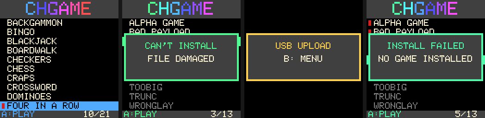
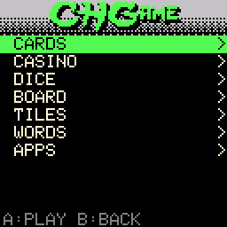
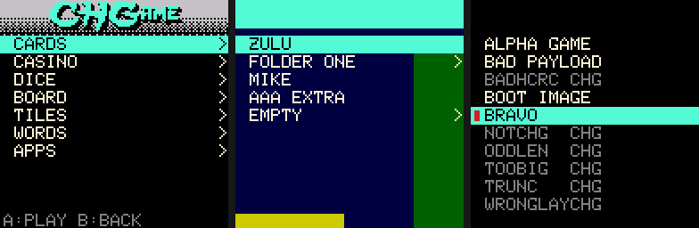
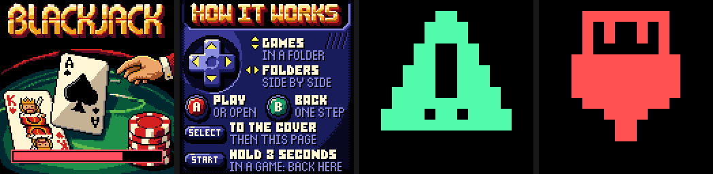

# CHGame bootloader with the SD game menu

The CHGame's permanent bootloader (flash 0x0000-0x2FFF, 12 KB), extended
with a game menu that installs games from a FAT microSD card. It keeps USB
uploading, the recovery paths and the memory map of the 0.2.4 bootloader.
The menu has two faces, built from the same sources (`build.sh --ui=`): the
**list menu**, a text list over the card's picture, and the **visual menu**,
one picture at a time and no text, in the manner of the Arduboy FX
([docs/visual-menu.md](../../docs/visual-menu.md)). The players' guide is
[docs/sd-menu.md](../../docs/sd-menu.md). What it
reads from the card is [spec/card.md](../../spec/card.md) (made by the
tools from a `.chgame`, [spec/chgame.md](../../spec/chgame.md)); the CHG
file it installs, and what a game needs to know, are in
[spec/chg.md](../../spec/chg.md).










## What it does

```
reset -> read and clear the boot request (16 B retained at 0x20000000)
 |- RUN "CHGR" and the installed program is valid -> jump to it (nothing else touched)
 |- USB "CHGB" (1200-baud touch, CHSDtoUSB, debug 'B') -> USB upload mode, panel says so
 |- B held at power-on                             -> USB upload mode, card and panel untouched
 '- otherwise (power-on, any other reset)
      pins to safe levels; panel reset; the card is read during the panel's 120 ms waits
      |- no card / no FAT volume / no entries: program valid -> RUN reset (no menu, as before)
      |                                        else          -> "NO GAMES" + USB mode
      |- power-on, START not held, GAMES/MENU.IDX flags a launch entry (followed into folders):
      |     installed -> RUN reset at once (the panel never woken)
      |     else      -> the menu opens on it (A installs it: a power-on never writes flash)
      '- the menu: GAMES/'s folders and *.CHG in MENU.IDX's order, then by title, over
         the folder's MENU.BG; the installed game marked and preselected
           A on a folder           -> its list; B goes back (4 levels)
           A on the installed game -> RUN reset (no flash write)
           A on another game       -> install, then RUN reset
           USB upload starts       -> "USB UPLOAD", protocol only (HELLO doesn't count)
USB mode has no timeout; a fresh press of B returns to the menu.
```

**The visual menu** (`--ui=visual`, `src/visual.c`) reads the same card and
the same rules, and draws pictures instead of the list
([spec/card.md](../../spec/card.md), "How the visual menu reads the card"):

```
the menu: the cover (GAMES/COVER.PIC) fades in and stays; behind it the installed
game is searched for (GAMES/'s games, then each folder, depth first), and A on the
cover shows it, with its border (on no card entry: SYSTEM.PIC 1, first in GAMES/)
  UP/DOWN      the folder's rows: its cover, then its games and sub-folders (round)
  LEFT/RIGHT   the folder beside: at the top GAMES/ and its folders in a ring;
               below, the folders of the same parent (it slides in from that side);
               nothing when there is no other folder
  A            a game: RUN, or install (a bar over its picture) then RUN;
               a folder: open it; a folder's cover: its first row;
               the cart's cover: the installed program's picture (A runs, B back)
  B            up a level; at the root or in a genre folder: the cart's cover;
               on the cart's cover: the about page (SYSTEM.PIC 0)
  SELECT       the cart's cover from anywhere; at the root: the about page
  START        nothing
the launch game: installed -> it starts at once, the panel never lit;
                 else the cover, then its picture, and A installs and starts it
a picture the card cannot give: SYSTEM.PIC's screen, else a built-in icon
```

**Leaving a game.** A game returns to the menu with a plain reset, so no
request is involved. The casino games do this when START is held for 3 s
(their shared `CHGame` core; [docs/sd-menu.md](../../docs/sd-menu.md)). The
reset flags show that the power did not go off, so a B still held then is
not taken for the power-on escape. The menu ignores keys that are already down when it appears, so the
START still held does not start anything.

**The install** (`src/install.c` over `src/update.c`, the same transaction a
USB upload uses):

1. **Pass 1, nothing erased.** Check the header (magic, header CRC, format,
   target and layout ids, payload size against the file size). Refuse a
   bootloader image (signature `CHBL`). Stream the whole payload along its
   FAT chain and check its CRC.
2. **Pass 2.**
   - Erase the metadata page: the installed program is invalid from this
     instant.
   - Write the payload page by page. Pages whose flash already holds the
     same bytes are skipped. Each page is read back. A card read error
     re-initialises the card and retries twice.
   - CRC what is now *in flash* against the header.
   - Program the metadata page last, without a second erase.
3. **Start it.** Wait for every key to be released, then RUN reset.

A power cut at any point leaves either the complete new program or no valid
program. Never a partial one, never the old one after the erase began. The
boot region is never written. The native suite cuts the power at every flash
operation of an SD install and of a USB upload and checks exactly this.

## Differences from the spec (`CH32SDBootloader.md`)

The spec was the baseline. These are the decisions taken with the owner, and
the measurements behind them.

| Spec | Here | Why |
|---|---|---|
| No LCD, font or menu in the bootloader; a `MENU.CHG` launcher installed into application flash | The menu is in the bootloader | Showing a flash-installed launcher would erase the game every time; the owner's goal is no flash wear. It fits: release build 11,908 B of 12,288 B (menu v2). |
| Game first at power-on; the menu on request | The menu at every power-on, the installed game preselected; a card may name a launch game instead (START held: the menu) | Arduboy FX behaviour, and free now: showing the menu writes nothing. The launch game came with menu v2. |
| Launcher copies the game to `UPDATE.CHG`, the bootloader installs that fixed name | The bootloader reads `/GAMES/*.CHG` itself; no SD writes at all | No FAT write code, no card corruption on a power cut, no 50 KB copy. |
| Fall back to raw sectors if FAT does not fit | FAT16 + FAT32, MBR or superfloppy, any fragmentation | Fits (FAT 864 B + SD 770 B without LTO). |
| Petit FatFs vs custom reader | The custom reader: a C port of CHSd's `Fat.cpp` | CHSd is already in the repository, tested against FAT16/FAT32 images and smaller than Petit FatFs in its read-only configuration. |
| (keep USB recovery) | USB upload unchanged, plus RUN by reset, no double erase, the bootloader signature | See below. |

**The decision gates (spec section 41):**
- **A.** The 12 KB reservation is kept and `APP_START` stays at 0x3000; see
  [SIZES.md](SIZES.md).
- **C.** Retained request plus reset is the only way the bootloader starts a
  program.
- **D.** Fragmentation is always supported.
- **E.** CMD17 single-block reads.
- **F.** Polled SPI, no DMA.
- **G.** The proven 256 B erase/program is kept.

## Changes to the 0.2.4 code (all covered by the native tests)

- **`update.c`, the shared flash transaction.**
  - BEGIN no longer pre-erases the image: each page was erased twice per
    upload.
  - Identical pages are skipped.
  - The metadata page is programmed without a second erase. It is the page
    every install erases, so this halves its wear.
- **RUN resets with a RUN request** instead of jumping, so a program always
  starts from reset state. `jump_to_app()` runs only at the very top of the
  boot.
- **The bootloader signature.** The release image carries `CHBL` in a
  reserved vector slot (offset 8), and `appmeta_check()` refuses any image
  that carries it. A bootloader staged for self-update can then never be
  launched as a program, even if the host stops between staging and
  promoting it. The Python uploader (`host/py`) also unlocks before staging.
- **Trims.**
  - The Arduino core 0.2.4's direct-register `USB_init`.
  - No `atexit`/`__libc_init_array`.
  - No SPL GPIO/RCC calls.
  - A 2 Hz blink in USB mode instead of the LED pattern module.
  - No `memcpy`.
- **`BOOT_VERSION` 2**, reported by HELLO; **3** with menu v2 (below);
  **4** once it keeps the system settings block (2026-11-20, below).
- **Menu v2 removed `fault.c`** (the bench LED reporter; a fault now stops
  the bootloader where it is) **and the STATUS and READ commands** (bench
  diagnostics: they answer `ST_ERR_BADCMD`; both uploaders skip `-verify`'s
  readback on BOOT_VERSION 3, where END's own CRC check of the flash
  remains).
- **Unchanged:** the HELLO payload, the upload and self-update commands, the
  USB identity, the memory map, the metadata format, the retained-block
  address and the `CHGB` request. Core 0.2.4 sketches and both host
  uploaders work as before.

## Building

```
./build.sh [release|locked|nomenu|app] [--board=rev0|rev1] [--ui=list|visual] [--style=rainbow|static] [--nolto] [--roomy]
```

The toolchain comes with the board package (`arduino-cli core install
CHGame:ch32v`) and is found in the usual Arduino folders, or set
`CHGAME_TOOLCHAIN`. On Windows, use Git Bash. Output goes to
`build/<mode>[-visual][-static][-rev1]/chgame_boot.{bin,elf,map,lst}`, and a size
report is printed. `--roomy` links a build that does not fit against a 16 KB
copy of the script, to see by how much (never flash it).

`--board` picks the board ([docs/hardware-revisions.md](../../docs/hardware-revisions.md)):
`rev1` (the default, the newest board: CHGame Rev1, which Rev 1.5 is too)
or `rev0` (the binaries rev0 has always had; `tools/dist.sh` names both).
The environment's `CHBOOT_BOARD_TARGET` (a target id, `0x31524743` for
rev1, empty or `0` for rev0) does the same; any other board stops the build
(`src/hal.h` has no pins for it). One board's bootloader must never go on the
other: their pins differ, and wrong pins drive a key's line.

| Mode | What | rev0 | rev1 |
|---|---|---|---|
| `release` | menu + USB upload + developer self-update. **The one to install.** | 11,952 B | 11,944 B |
| `release --style=static` | the same, colour 15 in the menu's text colour instead of the turning rainbow | 11,740 B | 11,736 B |
| `locked` | `release` without self-update; later bootloader updates then need the factory ISP | 11,612 B | 11,620 B |
| `nomenu` | **the USB-only bootloader**: USB upload + self-update, no menu, no card, no panel. The same code and conventions (the shared update path, RUN by reset, the signature, BOOT_VERSION 4), for a board built without an SD card. It drives the LED (rev0 PB9, rev1 PB10) and the USB pins and nothing else: every other pin stays high-Z, free for other circuits (rev1's backlight stays dark). Also hardware step HW2a | 5,336 B | 5,344 B |
| `app` | the menu as a program linked at 0x3000: a dry run of card, panel and keys under any bootloader, with no USB and no flash writes (HW1) | 6,408 B | 6,416 B |
| `release --ui=visual` | the visual menu + USB upload + self-update | 12,080 B | 12,084 B |
| `release --ui=visual --style=static` | the same, colour 15 as painted | 11,892 B | 11,888 B |
| `app --ui=visual` | the visual menu's dry run, as a program | 6,824 B | 6,832 B |

**Pins.** Every bootloader leaves the pins it does not use as reset leaves
them, floating inputs (high-Z) (`src/hal.h`). On rev0: the buzzer (PB10),
PB2, PB5, PB13-15, PC0-13, PA0-3 and PA8-15; the menu bootloaders drive the
panel (PA4, PB0, PB12), the card (PB11), SPI1 (PA5-7), the LED (PB9) and
the keys' pull-ups. On rev1: the buzzer (PA1), PA0 (VBUS sense), PA2/PA3,
PB2, PB5 (PB1's pad), PB13-15, PC1/PC2 and PC4-15 (the test pads PC14/PC15,
CC1/CC2 on Rev 1.5) stay high-Z; the menu bootloaders drive the panel (PA4,
PB4, PB12), its backlight (PB9: low until the panel shows the first frame
`lcd_on()` sent, then high), the card (PB3), SPI1 (PA5-7), the LED (PB10)
and the keys' pull-ups (PB0, PB1, PB6-8, PB11, PC0, PC3). The USB-only one
drives only the LED, so a board that puts the card's or the panel's pins to
another use sees nothing from it. The USB pins (PC16, PC17) are the USB
stack's in every build.

`tools/dist.sh` builds every mode for both boards: rev0's into
[release/](release) (`chgame_sdvisual.bin`, `chgame_sdvisual_static.bin`,
`chgame_visual_dryrun.bin` for the visual ones), rev1's under the same names
into [release/rev1/](release/rev1), and one `SHA256SUMS` for both (rev0's
lines as they always were, then `rev1/...`). It copies the five that Burn
Bootloader offers into the board package, rev0's to
`bootloaders/CHGame/` and rev1's to `bootloaders/CHGame/rev1/`. Two runs give
identical files.

### Menu v2 (2026-10-03): the card's look, folders, order, launch

The menu draws into a framebuffer and takes its look from the card
([spec/card.md](../../spec/card.md); the constants are
`shared/chgame_card.h`):

- **The framebuffer.** 128x128 pixels of 4 bits (8 KB of RAM; with the
  240-row game table the menu build uses 20,448 B of 20,480). It is sent to the panel through a
  16-colour palette, one row range at a time (`lcd_flush`).
- **Colour 15, two styles** (`./build.sh release --style=rainbow|static`;
  *Tools > Bootloader*: SD Text Menu (Rainbow), the default, or (Static)).
  It is the selection bar, the boxes and every `#FF00FF` pixel of a card's
  picture.
  - **Rainbow:** one colour turning through the colour wheel (`lcd_step`,
    every 40 ms, a turn in about 4 s); only the rows that show it are
    resent. (Until 2026-10-03 the hue also moved with x + y, a gradient:
    the solid colour is 48 B smaller and frees its 510 B table.)
  - **Static:** the palette's entry 15, like any other colour: the tools
    write the picture's `#FF00FF` there, so the picture shows as painted.
    No animation at all (11,684 B). (It was White until 2026-10-03, when
    entry 15 was white on every card.)
- **`MENU.BG`**, in GAMES/ or any folder below it (a folder without one keeps
  its parent's): a 128x128 picture with its palette. Colours 11-14 are the
  menu's text, greyed text, selected text and chip. It is read from the
  card again for every new picture: there is RAM for one copy, not two. Every
  card the tools prepare has one (`spec/assets/menu-default.png`: the CHGAME
  logo at full resolution, in colour 15). The logo is the picture's: the
  bootloader draws no title, and nothing over rows 0-19 and 120-127.
  Without a picture, or with a broken one, the list is drawn on black.
  `chgame background` makes and previews pictures
  ([docs/menu-image.md](../../docs/menu-image.md)).
- **Folders.** A folder is a row with `>`. A opens it, B goes back, 4
  levels deep. A folder lists 240 entries (`MENU_MAX_GAMES`, `menu.h`):
  each is 32 B of RAM, and 240 fill the RAM the framebuffer, the buffers
  and the 2 KB stack leave. More games go in folders, which have no limit.
  The first menu listed 128 games, all in `GAMES/`.
- **`MENU.IDX`.** It gives each folder's order, folder titles longer than
  8.3, and the launch flag. Entries it does not name follow, by title.
- **Launch.** At a real power-on with START not held, the flagged entry
  (followed into folders) runs at once if it is the installed game, with
  the panel never lit; otherwise the menu opens on it and A installs it
  (2026-10-06; until then it was installed and started unasked, which
  wrote over whatever game was in flash at every power-on). START held, or
  any software reset (a game's 3 s START exit), shows the menu.
- **Errors are numbers.** Every check is still made; only the text went.
  docs/sd-menu.md lists the codes: 1 card read, 2 damaged, 3 a bootloader
  image, 4 install failed (no game left installed), 5 not a CHG file it can
  install. A file the menu cannot read is shown grey under its 8.3 name.
- **What paid for it** ([SIZES.md](SIZES.md)): the error texts, `fault.c`,
  STATUS and READ, the exFAT diagnosis, the `n/N` counter, the plain and
  casino themes (a card's background replaces them), the fallback title,
  the rainbow's gradient, and out-of-line SPI bytes. The release image went
  from 12,032 B to 11,908 B.
- **A redraw** reads the background (17 sectors) and sends the whole screen.
  The model's wire time is about 25 ms; on the board scrolling felt right
  (2026-10-03: [test/hil/RESULTS-2026-10-03.md](test/hil/RESULTS-2026-10-03.md)).
- `python3 tools/screens.py` redraws the pictures in `docs/` after
  `test/native/run_tests.py -k boot`.

## Changes of 2026-11-20: the system settings block (BOOT_VERSION 4)

The metadata page's last 32 B, `0xF7E0`-`0xF7FF`, are reserved for system
settings: settings that belong to the handheld rather than to a game, none
defined yet (`src/chgame_map.h`'s `CHGAME_SYS_ADDR`/`CHGAME_SYS_SIZE`;
spec/chgame.md, "The system settings block"). Games cannot reach them
(uploads stop at `0xF700`, saves use `0xF500`/`0xF600`), but every earlier
bootloader erased them at each install. This one keeps them.

- **`update.c`:** `meta_put(len, crc)` builds the page with the header
  (none for `upd_begin()`, the image's for `upd_end()`), 0xFF after it,
  and the block copied from flash. A page with nothing to write is only
  erased, and an erased one only programmed, so while the block is blank
  an install costs the page one erase and one program, as before. Once it
  is written, a second erase: `upd_begin()` writes the block back right
  after clearing the header.
- **Self-update** clears the header through `upd_begin()`, so updating the
  bootloader keeps the block too. ABORT and the SD install already went
  through `upd_begin()`/`upd_end()`.
- **`flash.c`:** the two RAM-resident wrappers became one
  `flash_write_page(addr, data, region, erase)`, which pays for most of it:
  32 B less `.ramfunc`, in flash and in RAM.
- **Power cuts:** the block stays in flash throughout. A blank block is
  never touched; a written one can be lost only by a cut while the page
  itself is rewritten (`upd_begin()`'s and `upd_end()`'s erase and
  program), and nothing changes for the program's own safety.
- **Size:** list 11,952 B (+32), visual 12,080 B (+20; 208 free, 16 B above
  its gate), rev1 11,944 B and 12,084 B (204 free, 12 B above); RAM -32 B in
  every menu build ([SIZES.md](SIZES.md)).
- **Tests:** `t_sys_update` (both patterns: mixed bytes, and one byte
  programmed), `t_sys_usb` (ABORT, then an upload and RUN),
  `t_sys_powercut_sweep` (a cut at each flash operation of an upload: the
  block is intact after every one but those on the metadata page),
  `t_sys_selfupdate` and, in the menu suites, `t_sys_install`. Each fails
  with the block not kept. The blank-block counts of `t_update_basic` and
  `t_switch_game` are unchanged. The host model's `cut_addr` names the page
  a cut landed on.
- **On a board** (2026-11-20, the Rev 1.5, rev1 Graphic Menu, self-updated
  from v3 to v4). A bench probe (not kept: it rewrote the metadata page
  with the header as it was, which no sketch may do) wrote a 32-byte
  pattern into the block. The pattern then read back intact after each of:
  - the same image uploaded again;
  - another program (CHFour), then the probe;
  - BEGIN, a WRITE and ABORT ("no metadata"), then the probe;
  - a self-update (v4 over v4), then the probe;
  - a game installed from the card in the menu, then the probe.

  Every read showed the probe's own header intact and 0xFF between the
  header and the block. The probe then cleared the block, and CHFour went
  back on.

## Changes of 2026-11-17: rev1

The bootloader for CHGame Rev1 (and Rev 1.5, the same pins), from the same
sources: `build.sh --board=rev1`. Every rev0 binary is unchanged to the byte
(`tools/dist.sh`'s rev0 lines in `SHA256SUMS` are the ones before): each
rev1 difference sits under `#if defined(CHGAME_BOARD_TARGET)`, the rev0 code
in its `#else` as it was.

- **`src/hal.h`** includes `chg_format.h` before any board test (an
  undefined name in `#if` is 0, which would quietly give rev0's pins) and
  stops the build for any id but rev1's. Rev1's block has its pin words
  (GPIOA CFGLR `0xB8B34444`, GPIOB CFGLR `0x88433488` and CFGHR
  `0x44438338`, GPIOC CFGLR `0x44448448`; GPIOC CFGHR is never written),
  its levels (GPIOB set `0x19DB`, reset `0x600`: backlight and LED low;
  GPIOC set `0x9`), DC PB4, card CS PB3, LED PB10, and the USB-only build's
  LED on PB10 alone. `build.sh` and the PC suite compile with
  `-Werror=undef`.
- **Keys:** `HAL_KEYS(b, c)` turns the two ports' input words into the key
  bits, all within bits 0-8 so every mask is an immediate: UP, DOWN, B,
  SELECT and START read where they are (PB0, PB1, PB6-8), A (PB11) moves
  down to bit 4, RIGHT and LEFT (PC0, PC3) up to bits 2 and 5 together, and
  one XOR inverts the lot. It is plain C, so the PC suite tests it.
- **Backlight:** `hal_backlight_on()` drives PB9 high at the end of
  `lcd_on()`, after DISPON: the panel then shows the frame just sent (the
  menu's picture, or the visual menu's black). Until then the pin is driven
  low; B held at power-on never wakes the panel and leaves it dark; a reset
  (RUN, a jump) floats it, and the board's pull-down keeps it dark. On rev0
  it is nothing.
- **HELLO** sends the UID and the board field in one loop, the board field
  read from the image's own board word (offset 0x14): fewer bytes than the
  constant.
- **Size:** release 11,928 B (+8 against rev0), visual 12,064 B (224 free,
  32 B above its 192 B gate), nomenu 5,348 B (+8, the board field). They
  include the backlight's 40 ms wait after DISPON (2026-11-18: without it the
  first Rev1 board showed one white frame at power-on; the panel shows its
  RAM only from the next refresh). [SIZES.md](SIZES.md) has every build and
  the savings.
- **Tests:** every core suite checks its board's `HAL_KEYS` against its
  pins; `boot`, `boot_static`, `visual` and `visual_static` run again for
  rev1 (`*_rev1`) on packages packed for it, and their frames
  (`build/frames-rev1`) must match `frames.json`; a package for the other
  board is refused on each board; the panel model checks that the backlight
  comes on only over a written frame and stays dark with B held.

## Changes of 2026-10-07: board ids

A later board revision will move pins, so a bootloader, and the CHG files
it installs, must say which board they are for
([../../docs/hardware-revisions.md](../../docs/hardware-revisions.md)).
None of this changes a rev0 build: every binary `tools/dist.sh` makes was
compared and is byte-identical.

- **`shared/chg_format.h`** names each board's target id: `CHG_TARGET_REV0`
  (`CX35`, as before) and `CHG_TARGET_REV1` (`CGR1`, reserved). The
  `CHG_TARGET_ID` that `chg_check()` compares is the board the build is for:
  rev0's unless `CHGAME_BOARD_TARGET` is defined (a static assert refuses
  rev0's own id there, so a rev0 build always stays the plain one).
- **`build.sh`** takes `CHBOOT_BOARD_TARGET=0x31524743` from the environment
  for a later board. It reaches both the C and the startup file, and the
  output folder gets `-board<id>`. (Since 2026-11-17: `--board=rev1`, the
  folder `-rev1`, and rev1's pins.)
- **A later board's build reports itself.** `HELLO` grows by the board field
  (offset 30, `proto.c`), and the image carries the id at offset 0x14, a
  reserved vector slot (`startup_chgame_boot.S`; 0 on rev0). The uploaders
  refuse a bootloader image for another board than the one running
  ([../board/docs/protocol.md](../board/docs/protocol.md), "Which board").
  Cost: 16 B (list 11,936, visual 12,076), all of it the `HELLO` field.
- **Tests:** `test_core.c` checks `HELLO`'s length (30 B on rev0, 34 B with
  the board field) and, in every menu build, that `chg_check()` takes its
  own board's packages and refuses the other board's. `run_tests.py` adds
  `core_rev1`, built as rev1 would be. The constant check compares the
  board ids with `tools/chgpack.py`.

## Changes of 2026-10-06: power-on, launch, the static colour, the pins

Asked for by the owner after the cover-art work; the PC suite covers each
([SIZES.md](SIZES.md) has the bytes).

- **The visual menu stays on the cover at power-on.** It no longer fades to
  the installed game by itself: the cover is the menu's first picture, and
  A on it shows the installed game (B back, A again runs it). The search
  for the installed game still runs, behind the cover, so that a program
  on no card entry is listed first in `GAMES/` as before.
- **The launch game never installs by itself.** In both menus: if the
  flagged game is the one in flash it starts at once (the panel never lit);
  otherwise the menu opens on it (the visual menu: the cover, then its
  picture, no border) and A installs and starts it. So a power-on never
  writes over the game that was in flash.
- **The Static text menu draws colour 15 in the text colour** (the bar, the
  boxes, the picture's `#FF00FF`), not the hot pink the palette holds
  (`menu.c`'s `background()`; `chgame background --preview --style static`
  follows). The static visual menu still shows `#FF00FF` as painted.
- **LEFT and RIGHT do nothing when there is nowhere to go** (the visual
  menu at `GAMES/` without folders, or a folder with no sibling): `flip()`
  says whether it moved, and nothing slides when it did not.
- **The USB-only bootloader (`nomenu`) touches only the LED and USB**; the
  buzzer pin (PB10) is left floating in every build (it was held low).
- **Bytes.** The visual menu went from 12,080 to 12,060 B (`flush_all()`,
  one copy of `lcd_flush(0, LCD_H)`'s constants; the launch's hold and
  install call gone), the list menu from 11,908 to 11,920, the static list
  menu from 11,684 to 11,716, the USB-only one from 5,400 to 5,340.
- **CHG files carry a record** (later that day; `shared/chg_format.h`
  `CHG_OFF_RECORD`, spec/chg.md): JSON after the picture, for backing a card
  up. No menu reads it, and `chg_check()` already takes a file longer than
  its payload, so no code and no binary changed; the PC suite passes on the
  cards with records.

## Changes after the first hardware run (2026-10-01)

Found on a real board ([test/hil/RESULTS-2026-10-01.md](test/hil/RESULTS-2026-10-01.md)),
fixed and tried on that board again. Both cost no flash.
- **The B escape tests the power-on flag** (`hal_soft_reset()`, `hal.h`).
  It tested the software-reset flag, which the chip also sets at power-on,
  so B was never read and the menu always appeared.
- **The box is 8 pixels wider and the progress bar runs under the title.**
  A title is drawn 114 pixels wide and covered the inner border column of
  the 112-pixel box. The bar starts and ends where the title field does.
- **Run through the native tests on 2026-10-02.** The suite now also runs
  on Windows (see Testing). All of it passes; the twelve frames with a box
  were re-pinned in `frames.json`, and the pictures in `docs/` redrawn. The
  host model of the reset cause needed no change: `hal_soft_reset()` is
  modelled as a whole ("software reset and not power-on"), not flag by flag.

## Testing

```
python3 test/native/run_tests.py            # about a minute, both boards; needs cc and Pillow
```

On Windows the harness cannot run natively (it forks a process per boot).
There `run_tests.py` cross-compiles the test programs for Linux with zig
(`pip install ziglang`) and runs them under WSL: any distribution, even
Docker Desktop's, since the programs are static. That mode has UBSan but
not ASan. `$CHBOOT_WSL` names the distribution, `$CC` forces a native
compiler.

The portable sources are compiled for the PC against `test/native`'s
hardware layer:
- **`host_hal.c`**: a fake flash that tears the operation at a chosen power
  cut, the retained block, the virtual clock, scripted keys and a fake USB.
- **`sd_model.c`**: an SPI-level SD card. It covers SDSC v1/v2 and SDHC,
  slow initialisation, access time, error tokens and timeouts, and cards an
  MCU reset left in the middle of a multi-block read or write.
- **`lcd_model.c`**: an ST7735 that turns the real SPI byte stream into the
  picture on the glass and flags timing violations.

Each boot runs in a fresh process, so statics start from zero as after a
real reset; flash, the card and the panel persist in shared memory.

| Suite | Covers |
|---|---|
| core_nomenu / core_menu / core_locked / core_visual | the update path, the protocol (probes vs claims, resync after noise), self-update, the boot decision, a power cut at every flash operation of a USB upload; the board's key bits (`HAL_KEYS`) against its pins |
| core_rev1 | the same as core_menu, built for rev1: `HELLO`'s board field, the other board's packages refused, rev1's key bits (each key's pin alone gives its bit, every other pin nothing) |
| sd | the SD driver against the card model, the FAT reader against FAT16/FAT32 images (MBR, superfloppy, partition 4, fragmented files and folders, decoy labels, four kinds of broken chain, exFAT, blank), every CHG header error |
| boot | no card, empty card, menu, install, switch, every bad CHG file, USB notice, B escape, a probing host, upload at the menu, the card dying mid-install, a power cut at every flash operation of an SD install; and on cards made by `tools/chcart`'s `runtime.prepare()`: index order, an entry not in the index, an index record with no file, nested folders and B, launch (installed and not), START held at power-on, a software reset, a broken `MENU.BG`, an empty folder, a folder of 250 games (240 listed) |
| boot_static | the static style: the same menu's screens, install, folders and launch |
| boot_real | the real card from `chgame card` (`out/sdcard-rev0.img`, or `out/sdcard.img`), rev0 only: every program installed from a fresh board through its folder, checked |
| boot_rev1 / boot_static_rev1 / visual_rev1 / visual_static_rev1 | every boot and visual scenario again, built for rev1 and on packages packed for it |
| app / app_visual | the dry runs: no flash writes, a package checked, SELECT (visual: START) leaves |
| visual / visual_static | the visual menu (`test_visual.c`) on cards from `runtime.prepare()` with pictures: the splash (the cover stays, installed game or not), the search behind it (A on the cover: found, the first copy, not on the card), rows, the ring at the top and below (and LEFT/RIGHT doing nothing without folders), in and out of folders, the about page, install (and its bar), errors from SYSTEM.PIC and from the built-in icons, the card dying mid-install, a power-cut sweep, launch (installed: straight in, the panel dark; not installed: the cover, its picture, A installs; START held), the USB notice and an upload, broken pictures (offset past the file, cut short, a short COVER.PIC, no SYSTEM.PIC), a folder of 250 |
| visual_real | the real card in the visual menu: the splash, every folder's cover, every game's picture, and every program installed through its folder |
| frames | 112 screens of both menus pinned by hash in `test/native/frames.json` (the `real_*` ones only when the real card exists). PNGs are in `test/native/build/frames/`. `frames_rev1`: rev1's 78 (no real card) against the same hashes, in `build/frames-rev1/` |
| preview | `chgame background --preview` (tools/chcart/background.py) against the bootloader's own frames of a cart card: every pixel but the rainbow's (rainbow), every pixel (static) |
| pictures | the visual menu's frames against the pictures `tools/chcart` made: every pixel (static), every pixel but colour 15's (rainbow) |
| constants | `chgpack.py` and `chcart` against `chg_format.h`, `chgame_map.h` and `chgame_card.h`; `src/icons.h` against `art/icons/` |

The hardware steps are in [HARDWARE.md](HARDWARE.md).

## Installing it on a board

- **From the Arduino IDE, over USB** (any board that has a bootloader with
  self-update, the 0.2.4 one included): *Tools > Bootloader* **SD Text
  Menu (Rainbow)** (`release/chgame_sdboot.bin`) or **(Static)**
  (`release/chgame_sdboot_static.bin`), or **SD Graphic Menu (Rainbow)**
  (`release/chgame_sdvisual.bin`) or **(Static)**
  (`release/chgame_sdvisual_static.bin`), *Tools > Programmer* **CHGame
  USB**, *Tools > Burn Bootloader*.
  No driver, no buttons. The installed sketch is erased. It needs board
  package 0.3.0 or later, and 0.4.0 for a Rev1 (*CHGame Rev1* writes the
  files in `release/rev1/`).
- **By hand, the same thing:** `chgame-upload selfupdate
  release/chgame_sdboot.bin` ([host/go](host/go/README.md)), or
  `chgame uploader selfupdate release/chgame_sdboot.bin --yes` (the Python
  uploader, `host/py`).
- **Factory ISP:** hold BOOT across power-on, then `wchisp flash
  release/chgame_sdboot.bin` (a rev1: `release/rev1/chgame_sdboot.bin`).
- **A rev1 board** takes the files in [release/rev1/](release/rev1) and
  never rev0's (their image's board word, at 0x14, is `CGR1`; the uploaders
  refuse the other board's).
- **The first time:** [HARDWARE.md](HARDWARE.md) has two routes. The direct
  route goes straight to `chgame_sdboot.bin`, with fallbacks. The staged
  route is HW1, HW2a, HW2b.
- **The Arduino IDE caveat.** Board package 0.2.4 offers only the factory
  ISP and writes its own 0.2.4 bootloader. The Bootloader menu and the USB
  programmer came with 0.3.0, the Rev1 board and its bootloaders with
  0.4.0.

## Files

| Path | |
|---|---|
| `src/boot.c` | the boot decision, USB mode, `boot_reset()` |
| `src/card.c` | the card as both menus see it: GAMES/, a folder's entries (MENU.IDX's order, then by title), the installed game, the keys |
| `src/menu.c`, `lcd.c`, `font5x7.h` | the list menu (folders, order, launch, keys, boxes), the framebuffer and the panel, the font (capitals only) |
| `src/visual.c`, `src/icons.h` | the visual menu (pictures, the ring, the search, fades and slides); its built-in screens, generated by `tools/icons.py` from `art/icons/*.png` (never edited by hand) |
| `shared/chgame_card.h` | the menus' files on the card: `MENU.IDX`, `MENU.BG`, `COVER.PIC`, `SYSTEM.PIC` and its screens' order, the palette's roles ([spec/card.md](../../spec/card.md)) |
| `src/install.c`, `update.c` | the SD install and the flash transaction it shares with USB |
| `src/sd.c`, `fat.c` | SD card and FAT: a C fork of CHSd 1.0.0 (CLAUDE.md rule 4: changes found on hardware go back into CHSd too) |
| `src/chg.c`, `shared/chg_format.h` | the CHG header ([spec/chg.md](../../spec/chg.md)) |
| `src/hal.h` | pins, SPI, keys, LED, rev1's backlight, for rev0 and rev1: `static inline` on the board, functions on the PC |
| `src/proto.c`, `usb.c`, `flash.c`, `appmeta.c`, `jump.c`, `startup_chgame_boot.S`, ... | CH32SerialBoot 0.2.4, changed as listed above |
| `shared/chgame_bootreq.h` | the boot request reasons |
| `vendor/` | WCH SPL and the USB CDC stack (`vendor/usbcdc/VENDORED.md` lists the changes) |
| `host/go/` | `chgame-upload`, the Go uploader the board package installs ([its README](host/go/README.md)); built by `python tools/release/build_uploader.py` |
| `host/py/` | `chgame_upload`, the same uploader in Python (every verb and flag of the Go one): what the repository's tools and the hardware tests use (`python -m chgame_upload`, `chgame uploader`). `test/protocol/vectors.json` keeps the two in step |
| `test/protocol/` | the uploaders' parity tests (`python -m unittest discover -s platform/bootloader/test/protocol`, `go test` in `host/go`) |
| `test/hil/` | CH32SerialBoot's hardware tests |
| `test/native/` | the PC suite |
| `tools/` | `size_report.py`, `dist.sh`, `screens.py` (the pictures in `docs/`), `icons.py` (the visual menu's built-in screens), `bootcheck.py` (boot region read back over USB), `chgame_map.py`, `mkimage.py` |

## Where it came from

It began as the bootloader of CH32SerialBoot v0.2.4 (5de3006): that
repository's `bootloader/` flattened into this folder, plus `shared/`,
`host/py/`, `host/go/`, `test/` and two `tools/` scripts. CH32SerialBoot is frozen; this
folder is the bootloader's home, and the list of changes above is measured
against that starting point. MIT licence ([LICENSE](LICENSE)); third-party notices in
[THIRD-PARTY.md](THIRD-PARTY.md) and [NOTICE](NOTICE).
